<p align="center">
  
</p>

<h1 align="center">jquick-curl</h1>

<p align="center">
  <a href="https://central.sonatype.com/artifact/io.github.paohaijiao/jquick-curl"></a>
  <a href="https://github.com/dromara/jquick-curl/stargazers"></a>
  <a href="./LICENSE"></a>
  <a href="#快速开始"></a>
  <a href="https://github.com/akullpp/awesome-java"></a>
</p>
<p align="center">
  🌐 <a href="https://www.jquick.org">JQuick Website</a> ·
  📖 <a href="https://github.com/paohaijiao">GitHub</a> ·
  📦 <a href="https://central.sonatype.com/artifact/io.github.paohaijiao/javelin">Maven Central</a>
</p>
<p align="center">
  🔗 <a href="https://github.com/paohaijiao/jquick-curl">jquick-curl</a> ·
  📂 <a href="https://github.com/paohaijiao/jquick-path">jquick-path</a> ·
  📊 <a href="https://github.com/paohaijiao/jquick-excel">jquick-excel</a> ·
  📄 <a href="https://github.com/paohaijiao/jquick-pdf">jquick-pdf</a> ·
  ☕ <a href="https://github.com/paohaijiao/jquick-java">jquick-java</a> ·
  🗄️ <a href="https://github.com/paohaijiao/jquick-sql">jquick-sql</a>
</p>
<p align="center">
  <a href="./README.md">English</a> | <b>简体中文</b>
</p>

**jquick-curl** 是一款面向 Java 的轻量 HTTP 客户端。把请求写成一条熟悉的 curl 命令，集中维护在 XML 里，Java 侧只保留一个零注解的接口：自研命令解析器负责把命令翻译成请求，带连接池的高性能传输层负责执行，业务代码里没有手写的请求构建逻辑。jquick-curl 是 JQuick 生态的子项目，由 [Dromara](https://github.com/dromara/jquick-curl) 开源社区维护。

⭐ 本项目已被 [Awesome Java](https://github.com/akullpp/awesome-java) 列表收录。

<p align="center">
  
</p>

## 特性

- **XML 集中配置** —— 请求模板全部写在 `apis.xml`，改配置不改 Java 代码。
- **原生 curl 风格** —— 用 curl 命令描述请求，后端开发者零学习成本。
- **零注解接口** —— Java 侧只有普通接口，`factory.createApi(UserApi.class)` 一行变成客户端。
- **变量替换** —— 运行时解析 `#{name}` / `${name}` 占位符。
- **条件渲染** —— `<if test="...">` 表达式成立时才拼入对应的 header 或选项。
- **注解方式可选** —— 也可以用 `@JCurlCommand` 把命令直接写在接口方法上。
- **Cookie 支持** —— 手动设置 cookie、基于文件的 cookie 存储、`Set-Cookie` 持久化。
- **全量 HTTP 方法** —— `GET`、`POST`、`PUT`、`PATCH`、`DELETE`、`HEAD`、`OPTIONS`、`TRACE`。
- **文件传输** —— 通过 `-F` 做 multipart 上传，通过 `-o` / `--output` 下载。
- **批量执行** —— 一次调用执行类中所有 `@JCurlCommand` 方法。
- **超时、重试、重定向与连接池** —— 通过 `JQuickCurlConfig` 统一配置。
- **拦截器** —— 全局添加鉴权、日志或请求预处理逻辑。
- **代理与 SSL** —— 支持 HTTP / SOCKS5 代理，`-k` / `--insecure` 可跳过证书校验。

## 快速开始

### 1. 引入依赖

```xml
<dependency>
    <groupId>io.github.paohaijiao</groupId>
    <artifactId>jquick-curl</artifactId>
    <version>2.5.0</version>
</dependency>
```

### 2. 在 XML 中定义 GET 请求

请求模板集中在 `apis.xml`：一个 `<curl>` 标签对应一个 Java 方法，`name` 是方法名，`returnClass` 是返回类型，`#{name}` 是运行时变量。

```xml
<?xml version="1.0" encoding="UTF-8"?>
<!DOCTYPE curls PUBLIC "-//PAOHAIJIAO//DTD API CURL 1.0//EN"
        "classpath:paohaijiao/dtd/Jquick-curl.dtd">
<curls namespace="com.example.UserApi">
    <curl name="getUser" returnClass="java.lang.String">
        curl -X GET https://api.example.com/users/#{id}
    </curl>
</curls>
```

### 3. 用 &lt;if&gt; 条件渲染请求头

`<if test="...">` 表达式成立时，其中的选项才会拼入命令：

```xml
<curl name="getUser" returnClass="java.lang.String">
    curl -X GET https://api.example.com/users/#{id}
    <if test="withTrace == true"> -H "X-Trace: #{traceId}" </if>
</curl>
```

### 4. 定义 JSON POST 请求

同一个 XML 里可以继续声明更多接口，curl 选项原样书写：

```xml
<curl name="createOrder" returnClass="java.lang.String">
    curl -X POST https://api.example.com/orders
    -H "Content-Type: application/json"
    -d '{"sku":"#{sku}","count":#{count}}'
</curl>
```

### 5. 编写 Java 接口并发起调用

Java 侧只有一个零注解的接口和一行工厂调用，变量通过 `JQuickCurlReq` 注入：

```java
import com.github.paohaijiao.domain.req.JQuickCurlReq;
import com.github.paohaijiao.xml.JQuickCurlXmlParseFactory;
import com.github.paohaijiao.xml.factory.JQuickFactory;
import com.github.paohaijiao.xml.factory.JQuickXmlFactory;
import com.github.paohaijiao.xml.handler.JQuickParseHandler;

public interface UserApi {
    String getUser(JQuickCurlReq request);
    String createOrder(JQuickCurlReq request);
}

class Demo {
    public static void main(String[] args) throws Exception {
        JQuickParseHandler parser = new JQuickCurlXmlParseFactory();
        JQuickFactory factory = new JQuickXmlFactory(parser, "apis.xml");
        UserApi api = factory.createApi(UserApi.class);

        JQuickCurlReq request = new JQuickCurlReq();
        request.put("sku", "A-1001");
        request.put("count", "2");
        System.out.println(api.createOrder(request));
    }
}
```

`<curl name="...">` 的属性值必须与 Java 方法名一致；`#{name}` 从 `JQuickCurlReq` 中取值，`<if>` 的 test 表达式同样基于这些变量求值。

### 6. 读取响应报文与响应头

把 `returnClass` 声明为 `JQuickCurlResponseBody`，即可读取响应头，响应体可以多次读取：

```xml
<curl name="login" returnClass="com.github.paohaijiao.responseBody.JQuickCurlResponseBody">
    curl -X POST https://api.example.com/login -c ./cookies.txt
    -H "Content-Type: application/json"
    -d '{"user":"#{user}"}'
</curl>
```

```java
JQuickCurlResponseBody resp = api.login(request);

// 响应头与响应体
String firstSetCookie = resp.header("Set-Cookie");
String body = resp.asString();
```

## 注解方式：@JCurlCommand

不想维护 XML 时，也可以把命令直接写在接口方法上，用 `JCurlInvoker.createProxy` 创建代理：

```java
import com.github.paohaijiao.anno.JCurlCommand;
import com.github.paohaijiao.domain.req.JQuickCurlReq;
import com.github.paohaijiao.executor.JCurlInvoker;

public interface UserApi {

    @JCurlCommand("curl -X GET https://httpbin.org/get")
    String list(JQuickCurlReq request);

    @JCurlCommand("curl -X POST https://httpbin.org/post " +
            "-H 'Content-Type: application/json' " +
            "-d '{\"sku\":\"A-1001\",\"count\":2}'")
    String create(JQuickCurlReq request);
}

class AnnotationDemo {
    public static void main(String[] args) throws Exception {
        UserApi api = JCurlInvoker.createProxy(UserApi.class);
        System.out.println(api.list(new JQuickCurlReq()));
    }
}
```

注解代理使用 `${name}` 占位符，同样从 `JQuickCurlReq` 取值：

```java
@JCurlCommand("curl -X GET https://api.example.com/me -u ${user}:${password}")
String currentUser(JQuickCurlReq request);
```

```java
JQuickCurlReq request = new JQuickCurlReq();
request.put("user", "ada");
request.put("password", System.getenv("API_PASSWORD"));
```

敏感信息请通过变量注入，不要硬编码在命令里。

## 场景示例

### Cookie 与会话保持

jquick-curl 实现了原生 curl 的 cookie 选项：`-b` / `--cookie` 发送 cookie，`-c` / `--cookie-jar` 持久化 cookie。所有 cookie 会合并进同一个 `Cookie` 请求头，响应中的每个 `Set-Cookie` 都可以写入 Netscape 格式的 cookie 文件，该文件即充当持久化的 cookie 存储（CookieStore）。

```java
public interface CookieApi {

    // 手动设置：-b / --cookie，多个 cookie 用 ; 分隔
    @JCurlCommand("curl -X GET https://httpbin.org/cookies " +
            "-b 'sessionId=abc123; theme=dark; lang=en'")
    String withCookies(JQuickCurlReq request);

    // 等价写法：直接设置 Cookie 请求头
    @JCurlCommand("curl -X GET https://httpbin.org/cookies " +
            "-H 'Cookie: sessionId=abc123; theme=dark; lang=en'")
    String withCookieHeader(JQuickCurlReq request);

    // 从 Netscape cookie 文件加载：-b @file（注意 @ 前缀）
    @JCurlCommand("curl -X GET https://httpbin.org/cookies -b @./cookies.txt")
    String withJarFile(JQuickCurlReq request);
}
```

`-b` 与 `-H 'Cookie: ...'` 最终都会写入同一个 `Cookie` 请求头，同名 cookie 会合并而不是直接覆盖。

登录态复用的典型两步：先登录并落盘 cookie，再携带 cookie 访问受保护接口。

```java
public interface SessionApi {

    // 第一步：登录，并把每个 Set-Cookie 写入 cookies.txt（-c / --cookie-jar）
    @JCurlCommand("curl -X POST https://httpbin.org/post " +
            "-H 'Content-Type: application/json' " +
            "-d '{\"user\":\"ada\",\"password\":\"secret\"}' " +
            "-c ./cookies.txt")
    JQuickCurlResponseBody login(JQuickCurlReq request);

    // 第二步：下一条请求自动携带文件中的 cookie（-b @file）
    @JCurlCommand("curl -X GET https://httpbin.org/cookies -b @./cookies.txt")
    String profile(JQuickCurlReq request);
}

class SessionDemo {
    public static void main(String[] args) throws Exception {
        SessionApi api = JCurlInvoker.createProxy(SessionApi.class);
        JQuickCurlReq request = new JQuickCurlReq();
        api.login(request);
        System.out.println(api.profile(request));
    }
}
```

`-c` / `--cookie-jar` 会把每个 `Set-Cookie` 以 Netscape 格式（制表符分隔的 7 列）写入指定文件。请勿把真实的 cookie 文件提交到代码仓库。

### 文件上传与下载

```java
public interface FileApi {

    // Multipart 上传：-F 'file=@/path/to/file'
    @JCurlCommand("curl -X POST https://api.example.com/files -F 'file=@./report.pdf'")
    String upload(JQuickCurlReq request);

    // 文件与普通表单字段混传
    @JCurlCommand("curl -X POST https://api.example.com/import " +
            "-F 'userId=1001' -F 'file=@./report.pdf'")
    String uploadWithForm(JQuickCurlReq request);

    // 下载：-o / --output 把响应字节直接写入本地文件
    @JCurlCommand("curl -X GET https://api.example.com/files/report.pdf --output './download/report.pdf'")
    byte[] download(JQuickCurlReq request);
}
```

`-F` 支持同时上传多个文件，并可与普通表单字段混用；`--output` 由执行器直接写入磁盘，也可以声明 `byte[]` 返回类型后在业务代码中自行保存。以上命令同样可以写在 XML 的 `<curl>` 标签里。

### 批量执行

```java
import com.github.paohaijiao.anno.JCurlCommand;
import com.github.paohaijiao.responseBody.JQuickCurlResponseBody;
import com.github.paohaijiao.support.JQuickCurlBatchRunner;

import java.util.List;

public class BatchCommands {

    @JCurlCommand("curl -X GET https://httpbin.org/get")
    public String first() {
        return null;
    }

    @JCurlCommand("curl -X GET https://httpbin.org/uuid")
    public String second() {
        return null;
    }
}

class BatchDemo {
    public static void main(String[] args) throws Exception {
        JQuickCurlBatchRunner runner = new JQuickCurlBatchRunner();
        List<JQuickCurlResponseBody> results =
                runner.runCurlCommands(new BatchCommands(), JQuickCurlResponseBody.class);
        results.forEach(r -> System.out.println(r.asString()));
    }
}
```

批量执行会扫描目标类中所有带 `@JCurlCommand` 的公开方法，并按顺序依次调用。

### 超时、连接池与拦截器

```java
import com.github.paohaijiao.config.JQuickCurlConfig;
import okhttp3.Interceptor;

import java.util.concurrent.TimeUnit;

JQuickCurlConfig.getInstance()
        .connectTimeout(3, TimeUnit.SECONDS)
        .readTimeout(10, TimeUnit.SECONDS)
        .writeTimeout(10, TimeUnit.SECONDS)
        .connectionPool(50, 5, TimeUnit.MINUTES)
        .maxRetryCount(2)
        .followRedirects(true);
```

```java
// 全局拦截器，例如统一注入 Bearer Token
Interceptor auth = chain -> chain.proceed(
        chain.request().newBuilder()
                .addHeader("Authorization", "Bearer " + System.getenv("API_TOKEN"))
                .build());

JQuickCurlConfig.getInstance().addInterceptor(auth);
```

`JQuickCurlConfig` 是全局单例配置，统一管理超时、连接池、重试、重定向与拦截器；单个方法的超时可用 `@JTimeout` 覆盖。

## 已支持的 curl 选项

| 类别 | 支持的写法 | 用途 |
| --- | --- | --- |
| 请求方法 | `-X <METHOD>`、`--request <METHOD>` | 指定 HTTP 方法 |
| 请求头 | `-H 'Name: value'`、`--header 'Name: value'` | 添加请求头 |
| Cookie | `-b 'name=value'`、`--cookie`、`-b @file` | 发送 cookie 或加载 cookie 文件 |
| Cookie 存储 | `-c <file>`、`--cookie-jar <file>` | 把 `Set-Cookie` 持久化到文件 |
| 请求数据 | `-d`、`--data`、`--data-ascii`、`--data-binary`、`--data-raw` | 发送请求体 |
| 表单编码 | `--data-urlencode 'key=value'` | 发送 URL 编码表单数据 |
| Basic 认证 | `-u 'user:password'`、`--user` | 生成 Basic Authorization 请求头 |
| 重定向 | `-L`、`--location`、`--max-redirs <N>` | 跟随重定向并限制次数 |
| 文件上传 | `-F 'file=@/path/to/file'`、`--form 'key=value'` | multipart 上传或普通表单字段 |
| 文件下载 | `-o './file'`、`--output './file'` | 把响应字节写入本地文件 |
| 代理 | `-x 'host:port'`、`--proxy`、`--socks5-hostname` | 使用 HTTP 或 SOCKS5 代理 |
| 协议与日志 | `--http2`、`-k`、`--insecure`、`-v`、`--verbose`、`-s`、`--silent` | HTTP/2、跳过证书校验、详细或静默输出 |

以上选项均已由解析器与测试用例覆盖；未列出的 curl 选项请先验证后再使用。

## 文档

- [apis.xml](./src/main/resources/apis.xml) —— XML 接口定义示例。
- [Jquick-curl.dtd](./src/main/resources/paohaijiao/dtd/Jquick-curl.dtd) —— XML 定义文件的 DTD。
- [README.md](./README.md) —— English documentation.
- [Releases](https://github.com/dromara/jquick-curl/releases) —— 版本历史与更新说明。
- [Issues](https://github.com/dromara/jquick-curl/issues) —— 问题反馈与功能建议。

## 贡献

欢迎任何形式的贡献。

1. 修改代码前请先阅读 [CONTRIBUTING.md](./CONTRIBUTING.md)。
2. 提交 Issue 时请附上版本、运行环境、最小复现步骤和完整错误输出。
3. 提交 Pull Request 前请补充或更新测试，并保持每次改动聚焦。
4. 请勿提交密钥、Token、个人数据或生产环境配置。

## 许可证

jquick-curl 基于 [Apache License 2.0](./LICENSE) 开源。使用、修改或分发本项目时，请遵守协议条款，包括版权、专利与声明要求。
