<p align="center">
  
</p>

<h1 align="center">jquick-curl</h1>

<p align="center">
  <a href="https://central.sonatype.com/artifact/io.github.paohaijiao/jquick-curl"></a>
  <a href="https://github.com/dromara/jquick-curl/stargazers"></a>
  <a href="./LICENSE"></a>
  <a href="#quick-start"></a>
  <a href="https://github.com/akullpp/awesome-java"></a>
</p>
<p align="center">
  🌐 <a href="https://www.jquick.org">JQuick Website</a> ·
  📖 <a href="https://github.com/paohaijiao">GitHub</a> ·
  📦 <a href="https://central.sonatype.com/artifact/io.github.paohaijiao/javelin">Maven Central</a>
</p>
<p align="center">
  🔗 <a href="https://github.com/paohaijiao/jquick-curl">jquick-curl</a> ·
  📂 <a href="https://github.com/paohaijiao/jquick-path">jquick-path</a> ·
  📊 <a href="https://github.com/paohaijiao/jquick-excel">jquick-excel</a> ·
  📄 <a href="https://github.com/paohaijiao/jquick-pdf">jquick-pdf</a> ·
  ☕ <a href="https://github.com/paohaijiao/jquick-java">jquick-java</a> ·
  🗄️ <a href="https://github.com/paohaijiao/jquick-sql">jquick-sql</a>
</p>
<p align="center">
  <b>English</b> | <a href="./README-CN.md">简体中文</a>
</p>

**jquick-curl** is a lightweight HTTP client for Java. You describe each request as a plain curl command, keep all templates in one XML file, and the Java side stays a plain interface without a single annotation: the built-in command parser turns commands into requests, and a pooled, high-performance transport layer executes them — no hand-written request building code anywhere. jquick-curl is a sub-project of the JQuick ecosystem and is maintained by the [Dromara](https://github.com/dromara/jquick-curl) open-source community.

⭐ This project is included in the [Awesome Java](https://github.com/akullpp/awesome-java) list.

<p align="center">
  
</p>

## Features

- **Centralized XML configuration** — every request template lives in `apis.xml`; change configuration, not Java code.
- **Native curl style** — describe requests as curl commands, zero learning cost for backend developers.
- **Annotation-free interfaces** — the Java side is a plain interface; `factory.createApi(UserApi.class)` turns it into a client.
- **Variable substitution** — `#{name}` / `${name}` placeholders resolved at runtime.
- **Conditional rendering** — options are only spliced into the command when an `<if test="...">` expression is true.
- **Optional annotations** — or declare commands directly with `@JCurlCommand` on interface methods.
- **Cookie support** — manual cookies, a file-backed cookie jar, and `Set-Cookie` persistence.
- **Full HTTP method coverage** — `GET`, `POST`, `PUT`, `PATCH`, `DELETE`, `HEAD`, `OPTIONS`, `TRACE`.
- **File transfer** — multipart upload with `-F` and download with `-o` / `--output`.
- **Batch execution** — run every `@JCurlCommand` method of a class in a single call.
- **Timeouts, retries, redirects and connection pooling** — configured once through `JQuickCurlConfig`.
- **Interceptors** — add authentication, logging or request preprocessing globally.
- **Proxy and SSL** — HTTP / SOCKS5 proxy, plus `-k` / `--insecure` to skip certificate checks.

## Quick Start

### 1. Maven dependency

```xml
<dependency>
    <groupId>io.github.paohaijiao</groupId>
    <artifactId>jquick-curl</artifactId>
    <version>2.5.0</version>
</dependency>
```

### 2. Define a GET request in XML

All request templates live in `apis.xml`: each `<curl>` tag maps to one Java method — `name` is the method name, `returnClass` is the return type, and `#{name}` is a runtime variable.

```xml
<?xml version="1.0" encoding="UTF-8"?>
<!DOCTYPE curls PUBLIC "-//PAOHAIJIAO//DTD API CURL 1.0//EN"
        "classpath:paohaijiao/dtd/Jquick-curl.dtd">
<curls namespace="com.example.UserApi">
    <curl name="getUser" returnClass="java.lang.String">
        curl -X GET https://api.example.com/users/#{id}
    </curl>
</curls>
```

### 3. Render headers conditionally with &lt;if&gt;

Options inside `<if test="...">` are only spliced into the command when the expression holds:

```xml
<curl name="getUser" returnClass="java.lang.String">
    curl -X GET https://api.example.com/users/#{id}
    <if test="withTrace == true"> -H "X-Trace: #{traceId}" </if>
</curl>
```

### 4. Define a JSON POST request

Declare more endpoints in the same XML file, writing curl options exactly as you would on the command line:

```xml
<curl name="createOrder" returnClass="java.lang.String">
    curl -X POST https://api.example.com/orders
    -H "Content-Type: application/json"
    -d '{"sku":"#{sku}","count":#{count}}'
</curl>
```

### 5. Write the plain Java interface and call it

The Java side is just an annotation-free interface plus one factory call; variables are injected through `JQuickCurlReq`:

```java
import com.github.paohaijiao.domain.req.JQuickCurlReq;
import com.github.paohaijiao.xml.JQuickCurlXmlParseFactory;
import com.github.paohaijiao.xml.factory.JQuickFactory;
import com.github.paohaijiao.xml.factory.JQuickXmlFactory;
import com.github.paohaijiao.xml.handler.JQuickParseHandler;

public interface UserApi {
    String getUser(JQuickCurlReq request);
    String createOrder(JQuickCurlReq request);
}

class Demo {
    public static void main(String[] args) throws Exception {
        JQuickParseHandler parser = new JQuickCurlXmlParseFactory();
        JQuickFactory factory = new JQuickXmlFactory(parser, "apis.xml");
        UserApi api = factory.createApi(UserApi.class);

        JQuickCurlReq request = new JQuickCurlReq();
        request.put("sku", "A-1001");
        request.put("count", "2");
        System.out.println(api.createOrder(request));
    }
}
```

The `name` attribute of `<curl name="...">` must match the Java method name; `#{name}` values are read from `JQuickCurlReq`, and `<if>` test expressions are evaluated against the same variables.

### 6. Read the response body and headers

Declare `returnClass` as `JQuickCurlResponseBody` to access response headers; the body can be read multiple times:

```xml
<curl name="login" returnClass="com.github.paohaijiao.responseBody.JQuickCurlResponseBody">
    curl -X POST https://api.example.com/login -c ./cookies.txt
    -H "Content-Type: application/json"
    -d '{"user":"#{user}"}'
</curl>
```

```java
JQuickCurlResponseBody resp = api.login(request);

// Response headers and body
String firstSetCookie = resp.header("Set-Cookie");
String body = resp.asString();
```

## Annotation style: @JCurlCommand

If you prefer not to maintain XML, declare commands directly on interface methods and create the client with `JCurlInvoker.createProxy`:

```java
import com.github.paohaijiao.anno.JCurlCommand;
import com.github.paohaijiao.domain.req.JQuickCurlReq;
import com.github.paohaijiao.executor.JCurlInvoker;

public interface UserApi {

    @JCurlCommand("curl -X GET https://httpbin.org/get")
    String list(JQuickCurlReq request);

    @JCurlCommand("curl -X POST https://httpbin.org/post " +
            "-H 'Content-Type: application/json' " +
            "-d '{\"sku\":\"A-1001\",\"count\":2}'")
    String create(JQuickCurlReq request);
}

class AnnotationDemo {
    public static void main(String[] args) throws Exception {
        UserApi api = JCurlInvoker.createProxy(UserApi.class);
        System.out.println(api.list(new JQuickCurlReq()));
    }
}
```

The annotation proxy uses `${name}` placeholders, also resolved from `JQuickCurlReq`:

```java
@JCurlCommand("curl -X GET https://api.example.com/me -u ${user}:${password}")
String currentUser(JQuickCurlReq request);
```

```java
JQuickCurlReq request = new JQuickCurlReq();
request.put("user", "ada");
request.put("password", System.getenv("API_PASSWORD"));
```

Inject sensitive values through variables instead of hard-coding them in commands.

## Examples

### Cookies and session reuse

jquick-curl implements the cookie options of native curl: `-b` / `--cookie` for sending cookies and `-c` / `--cookie-jar` for persisting them. Cookies are merged into a single `Cookie` request header, and every `Set-Cookie` header can be saved to a Netscape cookie file that plays the role of a persistent cookie store.

```java
public interface CookieApi {

    // Manual cookies: -b / --cookie, separate multiple cookies with ;
    @JCurlCommand("curl -X GET https://httpbin.org/cookies " +
            "-b 'sessionId=abc123; theme=dark; lang=en'")
    String withCookies(JQuickCurlReq request);

    // Equivalent form: set the Cookie header directly with -H
    @JCurlCommand("curl -X GET https://httpbin.org/cookies " +
            "-H 'Cookie: sessionId=abc123; theme=dark; lang=en'")
    String withCookieHeader(JQuickCurlReq request);

    // Load cookies from a Netscape / Mozilla cookie file: -b @file
    @JCurlCommand("curl -X GET https://httpbin.org/cookies -b @./cookies.txt")
    String withJarFile(JQuickCurlReq request);
}
```

Both `-b` and `-H 'Cookie: ...'` end up in the same `Cookie` request header, and repeated names are merged instead of overwritten.

The typical login flow has two steps: sign in and persist the cookies, then reuse them on protected endpoints.

```java
public interface SessionApi {

    // Step 1: sign in and save every Set-Cookie into cookies.txt (-c / --cookie-jar)
    @JCurlCommand("curl -X POST https://httpbin.org/post " +
            "-H 'Content-Type: application/json' " +
            "-d '{\"user\":\"ada\",\"password\":\"secret\"}' " +
            "-c ./cookies.txt")
    JQuickCurlResponseBody login(JQuickCurlReq request);

    // Step 2: the next request carries the file cookies automatically (-b @file)
    @JCurlCommand("curl -X GET https://httpbin.org/cookies -b @./cookies.txt")
    String profile(JQuickCurlReq request);
}

class SessionDemo {
    public static void main(String[] args) throws Exception {
        SessionApi api = JCurlInvoker.createProxy(SessionApi.class);
        JQuickCurlReq request = new JQuickCurlReq();
        api.login(request);
        System.out.println(api.profile(request));
    }
}
```

`-c` / `--cookie-jar` writes every `Set-Cookie` in Netscape format (seven tab-separated columns). Never commit real cookie files to your repository.

### File upload and download

```java
public interface FileApi {

    // Multipart upload: -F 'file=@/path/to/file'
    @JCurlCommand("curl -X POST https://api.example.com/files -F 'file=@./report.pdf'")
    String upload(JQuickCurlReq request);

    // Upload a file together with normal form fields
    @JCurlCommand("curl -X POST https://api.example.com/import " +
            "-F 'userId=1001' -F 'file=@./report.pdf'")
    String uploadWithForm(JQuickCurlReq request);

    // Download: -o / --output writes the response bytes to a local file
    @JCurlCommand("curl -X GET https://api.example.com/files/report.pdf --output './download/report.pdf'")
    byte[] download(JQuickCurlReq request);
}
```

`-F` supports multiple files and can be mixed with plain form fields; `--output` writes to disk inside the executor, or declare a `byte[]` return type and handle the bytes yourself. All of these commands can also live inside a `<curl>` tag in XML.

### Batch execution

```java
import com.github.paohaijiao.anno.JCurlCommand;
import com.github.paohaijiao.responseBody.JQuickCurlResponseBody;
import com.github.paohaijiao.support.JQuickCurlBatchRunner;

import java.util.List;

public class BatchCommands {

    @JCurlCommand("curl -X GET https://httpbin.org/get")
    public String first() {
        return null;
    }

    @JCurlCommand("curl -X GET https://httpbin.org/uuid")
    public String second() {
        return null;
    }
}

class BatchDemo {
    public static void main(String[] args) throws Exception {
        JQuickCurlBatchRunner runner = new JQuickCurlBatchRunner();
        List<JQuickCurlResponseBody> results =
                runner.runCurlCommands(new BatchCommands(), JQuickCurlResponseBody.class);
        results.forEach(r -> System.out.println(r.asString()));
    }
}
```

Batch execution scans the target class for every public method annotated with `@JCurlCommand` and invokes them in order.

### Timeouts, connection pooling and interceptors

```java
import com.github.paohaijiao.config.JQuickCurlConfig;
import okhttp3.Interceptor;

import java.util.concurrent.TimeUnit;

JQuickCurlConfig.getInstance()
        .connectTimeout(3, TimeUnit.SECONDS)
        .readTimeout(10, TimeUnit.SECONDS)
        .writeTimeout(10, TimeUnit.SECONDS)
        .connectionPool(50, 5, TimeUnit.MINUTES)
        .maxRetryCount(2)
        .followRedirects(true);
```

```java
// A global interceptor, for example a Bearer token
Interceptor auth = chain -> chain.proceed(
        chain.request().newBuilder()
                .addHeader("Authorization", "Bearer " + System.getenv("API_TOKEN"))
                .build());

JQuickCurlConfig.getInstance().addInterceptor(auth);
```

`JQuickCurlConfig` is a global singleton that manages timeouts, the connection pool, retries, redirects and interceptors; a single method can override its timeout with `@JTimeout`.

## Supported curl options

| Category | Supported syntax | Purpose |
| --- | --- | --- |
| HTTP method | `-X <METHOD>`, `--request <METHOD>` | Set the HTTP method |
| Headers | `-H 'Name: value'`, `--header 'Name: value'` | Add request headers |
| Cookies | `-b 'name=value'`, `--cookie`, `-b @file` | Send cookies or load a cookie file |
| Cookie jar | `-c <file>`, `--cookie-jar <file>` | Persist `Set-Cookie` values to a file |
| Request data | `-d`, `--data`, `--data-ascii`, `--data-binary`, `--data-raw` | Send a request body |
| Form encoding | `--data-urlencode 'key=value'` | Send URL-encoded form data |
| Basic authentication | `-u 'user:password'`, `--user` | Generate a Basic Authorization header |
| Redirects | `-L`, `--location`, `--max-redirs <N>` | Follow redirects and cap the count |
| File upload | `-F 'file=@/path/to/file'`, `--form 'key=value'` | Multipart upload or form field |
| File download | `-o './file'`, `--output './file'` | Write response bytes to a local file |
| Proxy | `-x 'host:port'`, `--proxy`, `--socks5-hostname` | Use an HTTP or SOCKS5 proxy |
| Protocol and logging | `--http2`, `-k`, `--insecure`, `-v`, `--verbose`, `-s`, `--silent` | HTTP/2, skip cert checks, verbose or silent output |

The options above are covered by the parser and the test suite. Verify any unlisted curl option before relying on it.

## Documentation

- [apis.xml](./src/main/resources/apis.xml) — XML API definition sample.
- [Jquick-curl.dtd](./src/main/resources/paohaijiao/dtd/Jquick-curl.dtd) — DTD for the XML definition file.
- [README-CN.md](./README-CN.md) — Simplified Chinese documentation.
- [Releases](https://github.com/dromara/jquick-curl/releases) — version history and release notes.
- [Issues](https://github.com/dromara/jquick-curl/issues) — bug reports and feature requests.

## Contributing

Contributions of any kind are welcome.

1. Read [CONTRIBUTING-EN.md](./CONTRIBUTING-EN.md) (or [CONTRIBUTING.md](./CONTRIBUTING.md)) before making changes.
2. Include the version, environment, minimal reproduction and full error output when opening an issue.
3. Add or update tests before submitting a pull request, and keep each change focused.
4. Never commit secrets, tokens, personal data or production configuration.

## License

jquick-curl is open source under the [Apache License 2.0](./LICENSE). When using, modifying or distributing this project, follow the license terms, including copyright, patent and attribution requirements.
